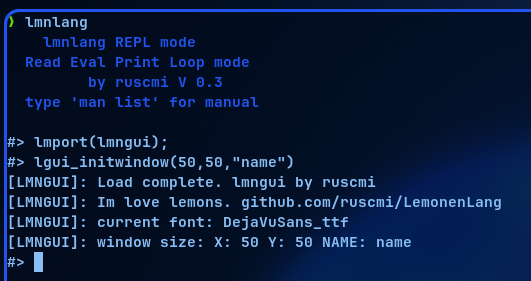
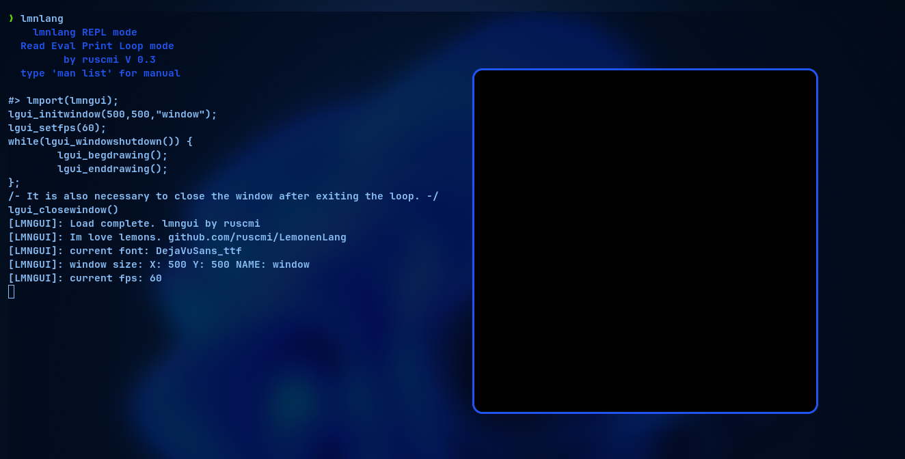

### Part one of lmngui documentation

**lmngui - a graphics library based on raylib (C++)**

This is the beginning of the documentation for this library. 
Here, I will demonstrate the use of basic functions, window initialization, 
and the drawing of shapes and text.

**WARNING: To work with the library, you need to import it at the beginning of the file or in REPL mode:**

```python
lmport(lmngui);
```

# basic functions without which your software's window cannot exist

**lgui_initwindow(width,height,window_name)**

This function initializes the lmngui window.

<p align="center">
	
</p>

**lgui_setfps(FPS)**

Sets the target frame rate.

**lgui_windowshutdown**

It has a boolean value; you start a loop in which you run a process indefinitely, 
with the condition being: as long as the window hasn't closed, output something every frame.

**lgui_begdrawing() && lgui_enddrawing()**

These functions indicate where all operations within the window begin and end.
They are used in a loop.

**From these functions, we can assemble this structure:**

```cpp
lmport(lmngui);
lgui_initwindow(500,500,"window");
lgui_setfps(60);
while(lgui_windowshutdown()) {
	lgui_begdrawing();
	lgui_enddrawing();
};
/- It is also necessary to close the window after exiting the loop. -/
lgui_closewindow()
```

This structure simply draws a window and runs an infinite loop inside it.

<p align="center">
	
</p>

soon...
